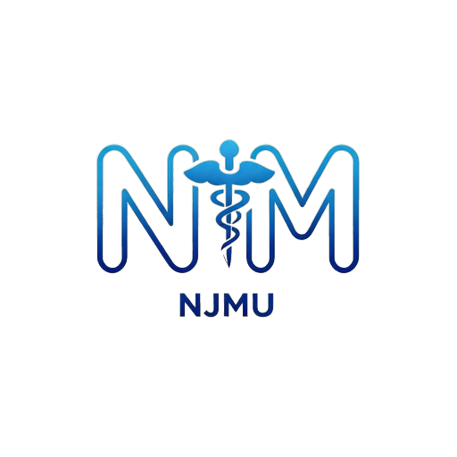

<div align="center">



# 南医助手 · NJMU-Helper

**把南医，装进口袋。**

南京医科大学教务信息鸿蒙原生客户端 · ArkTS / ArkUI · HarmonyOS NEXT

[](https://www.sydxky.cn/detail.php?id=1034)
[](https://developer.huawei.com/consumer/cn/harmonyos/)
[](LICENSE)
[](https://github.com/FengHDSL/XJAU-Helper)

[应用商店](https://www.sydxky.cn/detail.php?id=1034) · [直接下载 .hap](https://github.com/xiopeng32-ai/NJMU-Helper/releases/download/v2.2.2/NJMU-Helper-2.2.2.hap) · [开源鸿蒙版 .hap](https://github.com/xiopeng32-ai/NJMU-Helper/releases/download/v2.2.2/NJMU-Helper-2.0.15-oh.hap) · [全部版本](https://github.com/xiopeng32-ai/NJMU-Helper/releases) · [项目主页](website/index.html) · [界面预览](website/shots.html) · [更新日志](CHANGELOG.md) · [参与贡献](CONTRIBUTING.md)

</div>

> 本项目是 [FengHDSL/XJAU-Helper](https://github.com/FengHDSL/XJAU-Helper) 的衍生分支（Fork），针对南京医科大学的教务环境重写数据层与登录链路，并扩展了成绩导出、日历同步、云课堂等功能。详见 [NOTICE.md](NOTICE.md)。
>
> **非学校官方应用**，由南京医科大学学生独立开发与维护。

---

## 为什么做这个

每天查课表要开浏览器、输账号、过验证码、等页面加载；成绩出来了要一页页翻；考试安排散落在各处。南医助手把这些动作压缩成一次点击：打开即见今日课程，下拉即刷新成绩，桌面卡片直接显示下一节课和最近一场考试。

- **不收集密码**：账号密码只在设备本地用于向学校系统换取会话，不上传任何自有服务器。
- **不做二次分发**：所有数据来自你本人账号的实时请求，本地缓存，随时可清空。
- **不打扰**：无广告、无推送营销、无后台常驻。

## 功能一览

| 模块 | 能力 |
| --- | --- |
| 课程表 | 15 节南医大作息、周次切换、点阵周历、单双周与实践课、课程详情、一键导出到系统日历、课表原文件核对 |
| 成绩查询 | 学期切换、总评/GPA、成绩明细、**导出成绩单图片**（可勾选课程） |
| 学业情况 | 平均学分绩点、学业总评成绩（按南医大官方算法兜底）、修读情况与培养方案应修学分匹配、学业提醒、**导出学业概览图片** |
| 考试安排 | 考试时间地点、倒计时、写入系统日历 |
| 空闲教室 | 按教学楼与时间段查询空教室 |
| 校历 | 官方校历、周次定位、节假日与调休标注 |
| 消息与资讯 | 教务通知、学校官网通知、学院公告订阅、收藏与搜索 |
| 云课堂 | 智教云课程、课堂实录、课程通知（复用统一身份认证登录） |
| 桌面卡片 | 今日课程 2×2、课程预告、考试倒计时，免开应用 |
| 个性化 | 主题色、毛玻璃强度、字体、壁纸、深浅色、平板与横屏适配 |
| 数据安全 | `.xnd` 加密备份与恢复、本地缓存一键清空、操作日志 |

## 界面预览

完整交互预览见 [`website/index.html`](website/index.html)（纯静态，直接双击打开）。

## 技术栈

| 项 | 选型 |
| --- | --- |
| 语言 | ArkTS（TypeScript 超集，严格类型约束） |
| UI | ArkUI 声明式（`@Component` / `@Builder` / Navigation） |
| 应用模型 | Stage 模型 + `EntryAbility` / `FormExtensionAbility` / `BackupExtensionAbility` |
| 目标 SDK | HarmonyOS 6.x，`compatibleSdkVersion 26.0.0` |
| 网络 | `@kit.NetworkKit` HTTP + 自研 CookieJar（教务三 Cookie 会话） |
| 加密 | `@kit.CryptoArchitectureKit`（AES-128-CBC / 3DES / MD5）、`@kit.ArkTS` util |
| 存储 | `@kit.ArkData` preferences + 文件缓存 |
| 网页容器 | ArkWeb `Web` 组件（统一身份认证网页登录） |
| 卡片 | `@kit.FormKit` 动态卡片 |

规模：93 个 ArkTS 源文件，约 4.2 万行代码。

## 快速开始

### 环境

- DevEco Studio 6.0 及以上，HarmonyOS SDK API 26
- 一台 HarmonyOS NEXT 真机（模拟器无法完成教务登录与卡片调试）

### 构建

```bash
# 1. 克隆
git clone https://github.com/xiopeng32-ai/NJMU-Helper.git
cd NJMU-Helper

# 2. 用 DevEco Studio 打开本目录，等待 Sync 完成
# 3. 配置签名：File → Project Structure → Signing Configs
#    勾选 Automatically generate signature（需登录华为开发者账号）

# 4. 运行
#    选择 entry 模块与真机设备，点击 Run
```

> `build-profile.json5` 中的签名信息已清空，签名证书、`.p12`、`.p7b` 均不入库。
> 若使用命令行构建：
>
> ```bash
> hvigorw --mode module -p product=default assembleHap --no-daemon
> ```
>
> 产物位于 `entry/build/default/outputs/default/entry-default-signed.hap`。

## 目录结构

```
NJMU-Helper/
├── AppScope/                  # 应用级配置与图标
├── entry/
│   └── src/main/
│       ├── ets/
│       │   ├── api/           # 网络层：正方教务、CAS、云课堂、新闻
│       │   ├── common/        # 工具：存储、加密、日历、主题、更新日志
│       │   ├── model/         # 数据模型
│       │   ├── view/          # 页面与视图组件（30+）
│       │   ├── widgets/       # 桌面卡片
│       │   ├── entryability/  # 应用入口
│       │   └── entryformability/
│       └── resources/         # 字符串、颜色、图标、协议 HTML
├── config/                    # 教务接口端点配置
├── docs/                      # 文档与素材
└── website/                   # 项目介绍页（静态站点）
```

## 数据来源与登录

| 用途 | 系统 | 说明 |
| --- | --- | --- |
| 身份认证 | `authserver.njmu.edu.cn`（金智 IDS / CAS） | 网页登录获取 CASTGC → 换取 ST → 桥接教务会话 |
| 教务数据 | `jwpt.njmu.edu.cn`（正方 V9，`xxdm=10312`） | 课表、成绩、考试、学业、空教室、学籍 |
| 云课堂 | `zjy.njmu.edu.cn`（智教云） | 复用统一身份认证换取业务票据 |
| 资讯 | 学校官网 / 教学管理处 | 通知公告、校历 |

登录支持两种方式：**统一身份认证（默认）** 与 **教务系统直登**。首次登录若触发多因子认证，需在网页中完成一次扫码或「信任此设备」，之后即可无感重登。

## 隐私与合规

- 不设立自有服务器，不上传、不转售任何个人信息。
- 账号密码仅在本机内存与系统安全存储中使用，用于向学校系统发起请求。
- 本地数据可通过「我的 → 清空数据」随时删除；备份文件为 `.xnd` 加密格式，需密码才能导入。
- 完整条款见 [`docs/隐私政策.md`](docs/隐私政策.md) 与应用内「隐私协议」。

## 开源协议

[MIT License](LICENSE) © 2026 FengHDSL（上游） / NJMU-Helper contributors。

你可以自由使用、修改、分发本项目，包括商业用途，但需保留版权与许可声明。若你基于本项目适配其他学校，欢迎提交 PR 或在 Issue 中告知。

想把本项目发布到自己的 GitHub 账号（Fork 上游或独立建仓）？见 [`docs/发布开源指引.md`](docs/发布开源指引.md)。

## 致谢

- [FengHDSL/XJAU-Helper](https://github.com/FengHDSL/XJAU-Helper) —— 本项目的上游，提供了完整的鸿蒙教务客户端骨架与交互设计。
- HarmonyOS 开发者社区与所有提交 Issue、反馈问题的同学。

## 免责声明

本项目为个人学习与技术实践项目，与南京医科大学无隶属或合作关系，非官方应用。应用内所有数据的著作权归学校所有，数据以学校官方系统为准。请合理使用，勿用于任何商业用途或大规模抓取。
